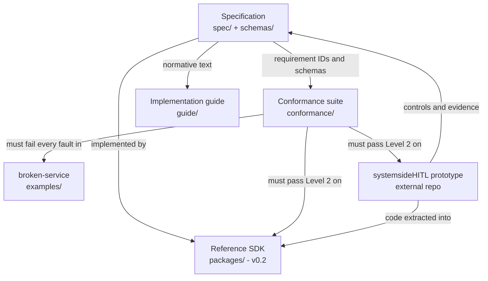
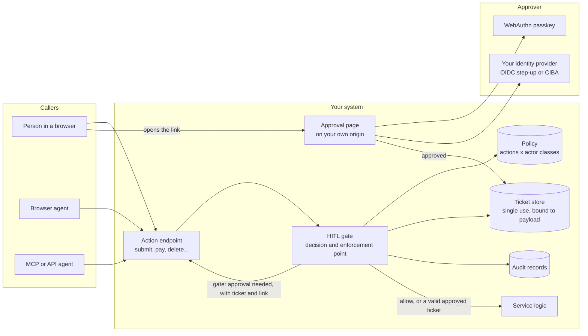
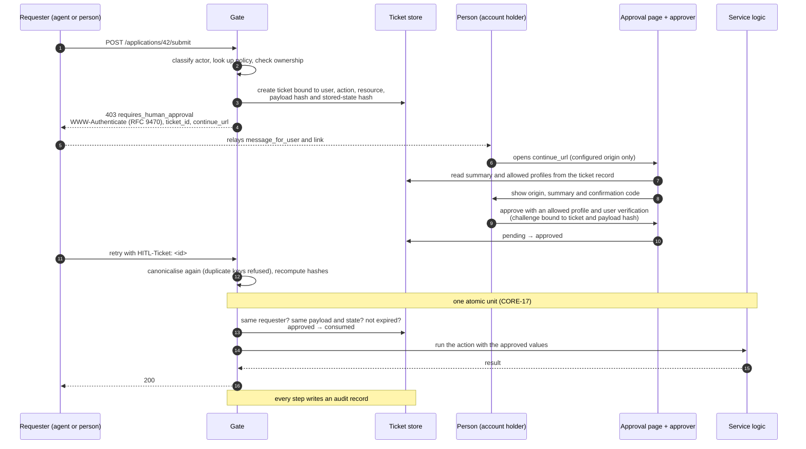
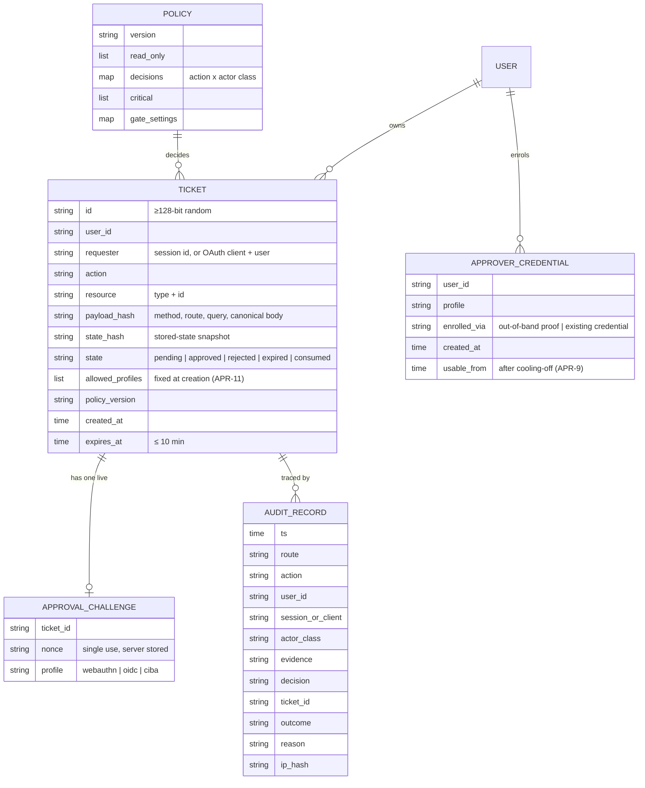
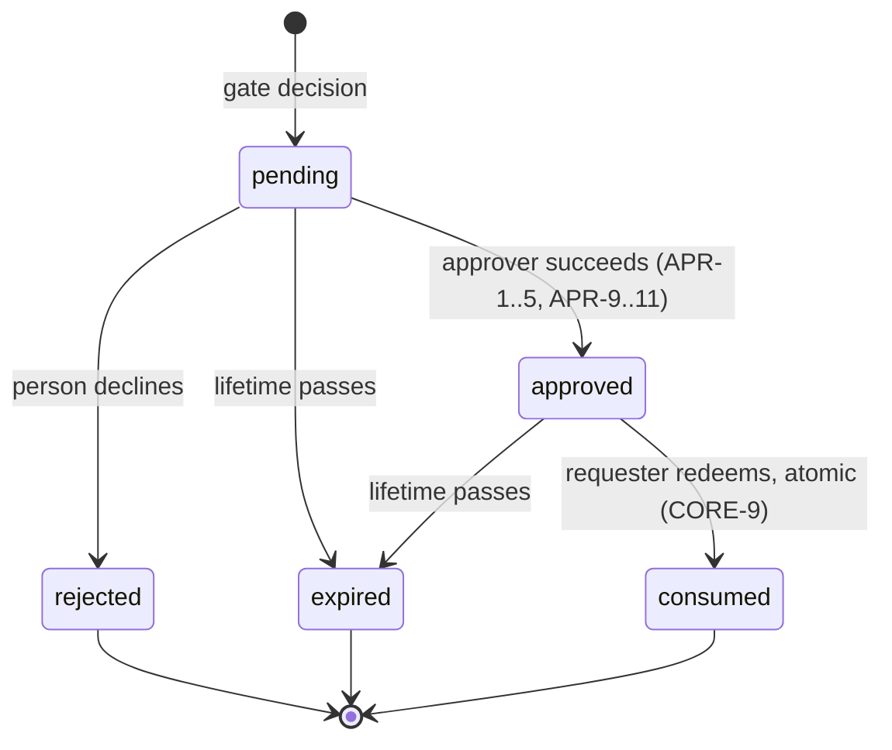
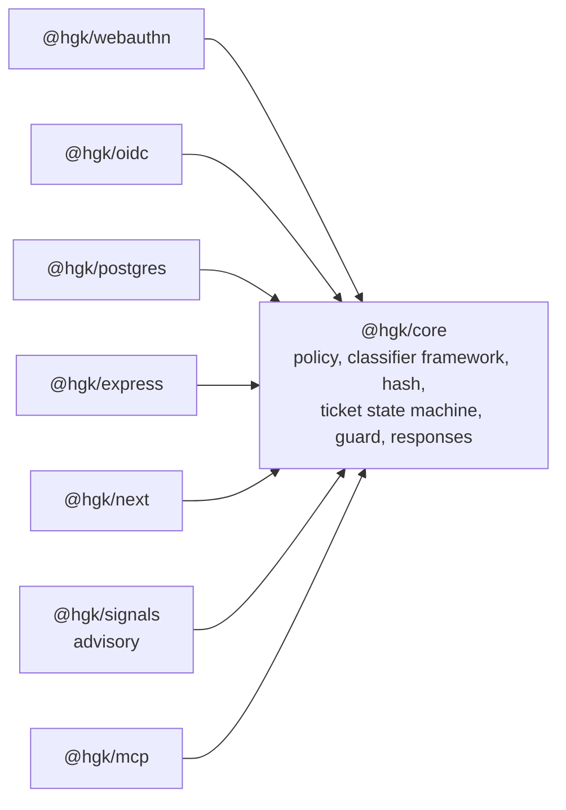
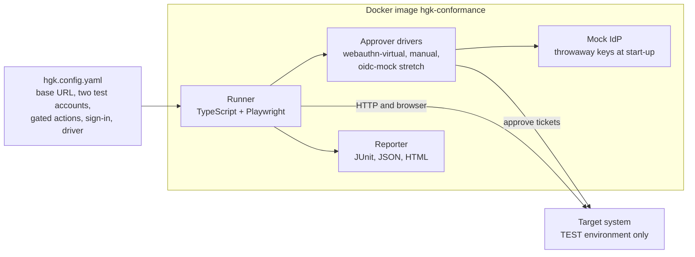

# HITL Gate Kit: Architecture

This document describes two things:
1. **The architecture the kit specifies:** how a conforming gate fits into an organisation's own system (sections 2-5).
2. **The architecture of the kit itself:** specification, conformance suite, guide and SDK, and how they relate (sections 6-9).

## 1. The four layers

Each layer can be used on its own.

| Layer | What it is | Who uses it | Release |
|---|---|---|---|
| **Specification (HGK)** | Requirements in RFC 2119 language, JSON Schemas, OpenAPI for the endpoints agents and approvers call | Developers, assessors | v0.1 |
| **Conformance suite** | Black-box HTTP and browser tests run as a Docker image against the adopter's test environment; JUnit, JSON and HTML report | Testers, assessors | v0.1 |
| **Implementation guide** | Threat model, choosing actions, integration patterns per stack, rollout, live-agent playbook, limitations | Everyone | v0.1 |
| **Reference SDK** (TypeScript) | `@hgk/*` packages extracted from the prototype | Node developers; a model for ports | v0.2 |



## 2. How a gate fits into an organisation's system



**Boundaries:**
- The gate sits **at the action boundary inside the system**, after authentication and before the service logic. It is not an edge product.
- The organisation keeps its own identity provider, sessions and database. The kit defines what the gate needs from them (section 7).
- An organisation with an existing policy decision point (OPA, Cedar, an AuthZEN service) can make the `allow / gate / deny` decision there. **Tickets and approval always stay in the gate; the policy engine never approves.**

## 3. A gated action, end to end



## 4. Requirements the specification defines

These IDs are proposals; each traces back to a prototype control or to a finding of the 2026-11-27 security review (SA-1 to SA-7, see [decisions.md](decisions.md)). They become normative text in K2.

### 4.1 HGK-Core (normative)

| ID | Requirement (summary) | Prototype control |
|---|---|---|
| CORE-1 | Every state-changing action passes one enforcement point; no route or tool bypasses it | C1, T11 |
| CORE-2 | Decision (`allow`, `gate`, `deny`) made on the server from a declared policy; unlisted, non-read-only actions are denied | C2, C4 |
| CORE-3 | Fail closed: an error gives `gate` (or `deny` for critical actions), never `allow` | C3 |
| CORE-4 | Resource ownership checked on every access | C5 |
| CORE-5 | Ticket bound to user, action, resource, request hash and stored-state hash. The request hash covers the method, the route template plus resource ID, the query and the canonical body, computed over the parsed values the service will receive, in a deterministic canonical form (RFC 8785 recommended). Refused, never hashed: input that can't be canonicalised, and objects with duplicate member names (I-JSON, RFC 7493). Volatile fields excluded from the hash must not affect the action's effect; the service runs on the approved values | T1, SA-3 |
| CORE-6 | Ticket IDs carry at least 128 bits from a CSPRNG | T4 |
| CORE-7 | Lifetime at most 10 minutes, checked on read and on use | T3 |
| CORE-8 | States `pending → approved → consumed`; `pending → rejected / expired`; nothing else | T5 |
| CORE-9 | Used exactly once, atomically; concurrent attempts produce one winner | T2 |
| CORE-10 | Only the requester redeems (same web session, or same OAuth client plus user); others get `wrong_session` | T6 |
| CORE-11 | Changed payload or stored state after approval gives `payload_mismatch` | T1 |
| CORE-12 | The gated response (section 4.2) | FR21, FR24 |
| CORE-13 | Approval links and redirects built from configured origins only | T7, S7 |
| CORE-14 | Messages to agents are declarative and addressed to the person; no model-directed instructions, no secrets | P1-P3 |
| CORE-15 | Ticket creation and approval attempts rate limited per user and per network address | T9 |
| CORE-16 | Observe mode needs a second switch and an end time at most 24 h ahead; announced while on; enforcement resumes by itself | C6, H6 |
| CORE-17 | Checking the requester, payload and stored state, consuming the ticket and running the action form one atomic unit: one transaction, or a compare-and-set on the stored state's version when the action runs. The action never runs without a committed consumption. If the transaction rolls back, the ticket is not consumed; if the action fails after a committed consumption, the ticket stays consumed and a new approval is needed | SA-1 |

### 4.2 The gated response (CORE-12)

- **Status:** `403` by default; `401` or `202` allowed as a deployment choice.
- **Header:** `WWW-Authenticate: Bearer error="insufficient_user_authentication", acr_values="<deployment URN>"` (RFC 9470).
- **Body** (JSON Schema in `schemas/`): `status: "requires_human_approval"`, `action`, `ticket_id`, `continue_url`, `message_for_user`, `resume { poll, retry_with_header, expires_at }`.
- **Other outcomes:** `denied`, `rate_limited`, `ticket_invalid` with reason `not_found | wrong_session | not_approved | rejected | expired | consumed | payload_mismatch`.
- **Retry:** `HITL-Ticket: <id>` header; `X-HITL-Ticket` accepted for compatibility; forms may send `hitl_ticket`. Header name confirmed in K2.
- **Status endpoint:** `GET <poll>` returns the ticket state to its requester only.
- **MCP profile:** the same body as a tool result, or MCP URL elicitation. Gated tools say so in their descriptions.
- **Poppy profile (optional):** the ticket maps to an `operation`; the agent's own approval never completes a gated step.

### 4.3 HGK-Approver

| ID | Requirement | Gap addressed |
|---|---|---|
| APR-1 | Approval cryptographically bound to this ticket and this payload hash | W2 |
| APR-2 | Approver is the ticket's account holder, with user verification | W1, W3 |
| APR-3 | An approval assertion can be used once | W2 |
| APR-4 | Approval page shows a summary from the ticket record, on the organisation's origin, and shows that origin prominently | T8, W4, SA-6 |
| APR-5 | A password alone can't enrol an approver credential. The first needs out-of-band proof through a channel the requesting agent can't read (for example an admin-issued code or identity proofing; never an email or SMS link alone); later ones need an existing credential | W12, H1, SA-4 |
| APR-6 (should) | With agent evidence or suspected handover, approve on a different device or session. The approving device shows the ticket summary (APR-4) and uses a credential bound to the organisation's origin (WebAuthn on that device, or the platform's WebAuthn hybrid transport). Where the approval channel is not origin-bound (OIDC with a phishable method, CIBA push), apply the cross-device mitigations of the IETF cross-device security BCP: a confirmation code the person must match, approval started by the person, and a proximity check where possible | H2, H3, SA-6 |
| APR-7 (should) | Confirmation code on both screens; limit pending approvals; cool down after a decline | H4 |
| APR-8 (may) | Attestation policy where the population allows it | H5 |
| APR-9 | Credential management and recovery are gated: adding or removing an approver credential and changing recovery details are `critical` actions in every policy (POL-1). Recovery that leaves no approver credential falls back to the first-credential rule in APR-5. The account holder is notified on every registered channel when a credential is added or removed. A new credential should not approve tickets until a cooling-off period, set in the policy's gate settings, has passed | SA-4 |
| APR-10 | The approval page and its endpoints are hardened: only the ticket's account holder, signed in, can view a ticket; framing blocked (`frame-ancestors 'none'`); CSRF protection on approve and decline; approval-only cookies are `__Host-` and `SameSite=Strict`; a Content Security Policy; `Referrer-Policy: no-referrer` (the ticket ID is in the URL); `Cache-Control: no-store`. User-controlled values in the summary are escaped, and bidirectional-override and confusable characters are neutralised or flagged | T8, SA-7 |
| APR-11 | No approval-method downgrade: the ticket records, when created, the approver profiles the policy allows for its action and the policy version; an approval through any other profile is refused | SA-5 |

| Profile | Binding | Status |
|---|---|---|
| **WebAuthn** | Challenge `SHA-256(ticket_id ‖ payload_hash ‖ nonce)`, `userVerification: required`, origin and RP ID checked, credential belongs to the ticket's user | Complete (proven in the prototype) |
| **OIDC step-up** | `acr_values`, `max_age=0`, `nonce = base64url(SHA-256(ticket_id ‖ payload_hash ‖ server nonce))`; verify signature, `iss`, `aud`, `nonce`, `acr`, `auth_time`. `acr` or `amr` (RFC 8176) must show a phishing-resistant method, and `auth_time` must be later than the ticket's `created_at`, so an existing single sign-on session can't approve | Draft until validated with two identity providers |
| **CIBA with RAR** | `binding_message` with the confirmation code; `authorization_details` naming action and resource | Draft (v0.3) |

### 4.4 HGK-Policy, HGK-Actor, HGK-Audit, HGK-Rollout

- **Policy (normative):** YAML or JSON with a JSON Schema: a `version`; `read_only` actions; per-action decisions for each actor class (`human`, `declared_agent`, `suspected_agent`, `unknown`); `critical` actions; gate settings (lifetime, allowed approver profiles per action, credential cooling-off period). Loaded at start-up, read-only; invalid policy stops start-up. AuthZEN mapping: subject = user plus actor class; action; resource = type plus ID; context = route and evidence.
  - **POL-1:** the start-up check refuses a policy in which, for any action that isn't read-only, the decision for `human` or `declared_agent` is looser than the decision for `unknown` (strictness: `deny` > `gate` > `allow`). Actor classes come from evidence an agent may forge, so a class can make a decision stricter but never looser. Approver credential management and recovery actions (APR-9) must be listed as `critical`, and no actor class may `allow` them. (SA-2, SA-4)
- **Actor (mostly informative):** normative parts are the classes, the evidence precedence (protocol identity > self-declaration > behaviour score > default), **escalate-only** within a session, and detection **never loosens** a decision. Signals are informative, with an explicit warning that they may score 0 for modern agents.
- **Audit (normative minimum):** a record for every decision, ticket change, approval, decline, redemption, denial and observe-mode decision. Never secrets, tokens, enrolment codes or assertions.
- **Rollout (informative):** observe (time-boxed) → tune → freeze → enforce. Detection rates only reported after the freeze.

## 5. Data model

The entities a conforming gate needs. The specification defines fields and invariants, not a database schema; `@hgk/postgres` (v0.2) gives one concrete schema.



**Ticket state machine (CORE-8):**



**State ownership:** the gate alone writes tickets and challenges. The approval page moves a ticket from `pending` only through the approver. The policy is read-only at runtime. Audit records are append-only.

## 6. Failure handling

| Failure | Behaviour |
|---|---|
| Classifier or policy error | Fail closed: `gate`, or `deny` for critical actions (CORE-3) |
| Invalid policy at start-up, including a POL-1 violation | Start-up stops |
| Payload can't be canonicalised (`NaN`, lone surrogates, non-JSON values, duplicate member names) | Request refused, never hashed (CORE-5) |
| Concurrent redemption | Atomic conditional update; one winner, others get `consumed` (CORE-9) |
| Stored state changes between check and execution | The compare-and-set or transaction fails; the action doesn't run (CORE-17) |
| Action fails after the ticket is consumed | Ticket stays consumed; a new approval is needed (CORE-17) |
| Approval through a profile the ticket doesn't allow | Refused; ticket stays `pending` (APR-11) |
| New approver credential used during its cooling-off period | Approval refused; account holder already notified (APR-9) |
| Requester loses its live status stream | Polling is the contract; streaming is a convenience |
| Approval storm | Rate limits (CORE-15) and pending-approval cap (APR-7) |
| Observe mode left on | Ends by itself at its end time, at most 24 h (CORE-16) |

## 7. Adopter ports (reference SDK, v0.2)

What an organisation supplies to `@hgk/core`. The specification describes the same needs in language-neutral terms for other stacks.

| Port | What it supplies |
|---|---|
| `ActionRegistry` | Per gated action: name, resource ID, a precondition check returning the stored-state snapshot and preview, volatile fields |
| `SessionAdapter` | User, session or client ID, sign-in method, an approval-only session for the approval page |
| `Storage` | Atomic conditional updates for tickets and challenges; rate-limit counters; audit records |
| `Approver` | One of the profiles in section 4.3 |
| `AuditSink` | Database, log pipeline or SIEM |
| `Clock` | Testable time |



`@hgk/core` depends only on platform crypto and a schema validator. No framework or database code.

## 8. Conformance suite



- **Black-box:** the suite only sees HTTP and the browser. The target exposes test-mode hooks: an enrolment code for a test passkey, a short ticket lifetime, an audit export.
- **Safety:** refuses a base URL marked as production unless explicitly overridden.
- **Test catalogue:** about 30 tests in v0.1, grouped as gate coverage, tickets, responses, approver, limits and modes, audit (Level 2) and MCP (Level 3). Each test names the requirement IDs it covers.
- **Self-test:** `examples/broken-service` has one switch per fault (allow reuse, skip the payload check, accept any account's approval, build URLs from the request, run the action outside the consume step, accept duplicate JSON keys, ignore the method or query in the hash, accept a policy where `human` is looser than `unknown`, accept a profile the ticket doesn't allow, let a password session add an approver credential, drop the approval page's security headers, and so on). CI runs the suite against each switch and fails if any fault goes undetected.

## 9. Repository structure

```
hitl-gate-kit/
  spec/                 HGK-Core, -Approver, -Policy, -Actor, -Audit, -Rollout
  schemas/              JSON Schemas + OpenAPI
  conformance/          suite source, Dockerfile, mock IdP, sample hgk.config.yaml
  examples/
    broken-service/     deliberately faulty target (suite self-test)
    express-minimal/    smallest correct integration (v0.2)
  packages/             @hgk/* (v0.2)
  guide/                implementation guide
  docs/                 PRD, decisions, architecture, design, implementation plan, tests/
  .github/              CI (actions pinned to SHA), CODEOWNERS, templates
  SECURITY.md  CONTRIBUTING.md  CHANGELOG.md  LICENSE  LICENSE-spec
```

## 10. Scalability, hosting and supply chain

- **No hosting.** The kit provisions no cloud resources; a cloud reference architecture does not apply. It runs in the adopter's system and CI.
- **Scaling the gate** is the adopter's concern, but the specification keeps it simple: tickets are short-lived rows with atomic conditional updates, so any database with compare-and-set works; no locks or extra infrastructure.
- **Suite cost:** one container, about 30 tests, minutes per run; fits a pull-request CI job.
- **Supply chain:** CI on every pull request runs format, lint, typecheck, unit tests, schema validation, the conformance self-test, secret scan, dependency review and static analysis. Third-party actions pinned to commit SHAs; changes to CI or build files need owner review. Releases: signed tags, npm provenance, CycloneDX SBOM, signed container image, SLSA build level 2 to start; always human-gated.
