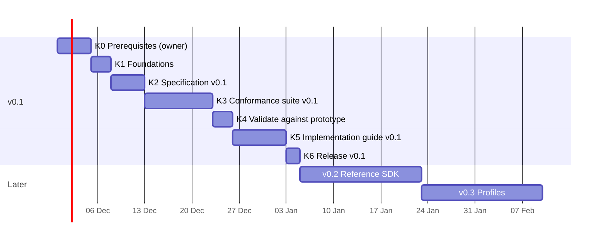

# HITL Gate Kit: Implementation plan

**Prototype** means [systemsideHITL](https://github.com/WilsonWordsofWisdom/systemsideHITL). Each step ends with a check that proves it is done.

**Rules throughout:**
- Test-first for anything that enforces a requirement.
- No secrets, live test data, results files or unreviewed research notes in this public repository.
- Third-party GitHub Actions pinned to commit SHAs; every CI or build change flagged for owner review.
- Tests are never deleted or weakened to make CI pass.
- Push, release and publishing are human-gated.

## Owner decisions needed

| # | Needed by | Decision | Status |
|---|---|---|---|
| O1 | Before the first content push | Licence for specification and guide text: MIT (like the code) or CC BY 4.0 | **Open** |
| O2 | Before the first content push | Confirm the right to publish this work | **Open** |
| O3 | K1 | Sign-off on PRD, architecture and design | **Open** |
| O4 | K3 | Container registry name for the suite image (`ghcr.io/<owner>/hgk-conformance`) | **Open** |
| O5 | K5 | An outside developer to read through the guide | **Open** |
| O6 | v0.2 | Two identity providers to validate the OIDC step-up profile | **Open** |

## Timeline

Dates are illustrative (working days); K0 depends on owner time.

## K0. Prerequisites

**Repo:** Owner, Prototype · **Effort:** owner time

1. Decide O1 and O2 and log them in [decisions.md](decisions.md). → verify: decisions logged before anything beyond these planning docs is pushed.
2. More Phase 6 runs in the prototype: Muse in enforce through to payment; prompts P2 and P3; the covert variant (`SELF_DECLARE_UI=off`); at least two more agents. → verify: results files merged in the prototype (they stay there; the guide uses summaries only).

## K1. Foundations

**Repo:** Kit · **Effort:** 2-3 days

1. Living docs: `PRD.md`, `decisions.md`, `architecture.md`, `design.md`, this plan. → verify: owner sign-off (O3).
2. `docs/tests/KJ1…KJ6.feature`: Gherkin, one file per PRD journey. → verify: every PRD journey maps to a feature file.
3. Mockups of the conformance report and the reference approval page ([design.md](design.md) sections 1 and 3). → verify: owner sign-off.
4. Repository hygiene: `SECURITY.md` (GitHub private vulnerability reporting), `CONTRIBUTING.md`, `CODEOWNERS`, `CHANGELOG.md`, `LICENSE-spec` (from O1), issue and pull-request templates, `.gitignore` covering `.env`, results and reports. → verify: files present; `.env.example` holds placeholders only.
5. CI skeleton: format, lint, Markdown and schema validation, secret scan (gitleaks), dependency review, static analysis (CodeQL or Semgrep); all actions pinned to SHAs. → verify: CI green on an empty pull request.
6. Branch protection on `main` with required reviews; OpenSSF Scorecard. → verify: a direct push to `main` is refused.

## K2. Specification v0.1

**Repo:** Kit + Prototype · **Effort:** about 1 week

1. `spec/HGK-Core.md`: CORE-1 to CORE-17 and the gated response, in RFC 2119 language. → verify: each requirement has a rationale, a source (prototype control or security-review finding) and a planned test.
2. `spec/HGK-Approver.md`: APR-1 to APR-11; WebAuthn profile complete; OIDC step-up and CIBA marked **Draft**. → verify: the WebAuthn profile matches what the prototype does, and each gap against APR-9 to APR-11 is logged for K4.
3. `spec/HGK-Policy.md` with POL-1 and the AuthZEN mapping; `spec/HGK-Actor.md`, `spec/HGK-Audit.md`, `spec/HGK-Rollout.md`. → verify: owner review.
4. `schemas/`: JSON Schemas for the gated response, `denied`, `rate_limited`, `ticket_invalid`, policy and audit record; OpenAPI 3.1 for the status endpoint, approval endpoints and gated-action responses. → verify: schemas validate the prototype's real responses (captured in its test environment, not committed if they carry run data).
5. `spec/index.md`: requirement ID index tracing each ID to a prototype control or security-review finding, and to a conformance test. → verify: no ID without a source and a test.
6. Run the prototype's `canonicalJson` against the RFC 8785 test vectors; log each difference as a decision. A fix in the prototype gets its own pull request and test. → verify: the check passes, or every difference is decided.
7. Confirm the retry header name (`HITL-Ticket`, with `X-HITL-Ticket` accepted). → verify: decision logged.

## K3. Conformance suite v0.1

**Repo:** Kit · **Effort:** 1½-2 weeks

1. Runner (TypeScript + Playwright) and the `hgk.config.yaml` format with a JSON Schema and a sample config. → verify: an invalid config fails with a clear message.
2. Approver drivers: `webauthn-virtual` and `manual`; `oidc-mock` as a stretch, with throwaway keys generated at start-up. → verify: each driver approves a ticket on `broken-service` with no faults switched on.
3. Test catalogue (about 30 tests) in the groups in [architecture.md](architecture.md) section 8, each tagged with requirement IDs. → verify: every Level 1 and Level 2 requirement has at least one test.
4. Production guard: refuse a base URL marked as production without an explicit override. → verify: unit test.
5. Reporters: JUnit XML, JSON, self-contained HTML (from the signed-off mockup); `--require-level` exit code. → verify: report renders for pass, fail, skip and could-not-start runs.
6. `examples/broken-service` with one switch per fault (allow reuse, skip the payload check, skip the state check, accept any account's approval, build URLs from the request, no expiry, no rate limit, observe with no end time…). → verify: **every switch makes its matching test fail**; with no switches the service passes Level 2.
7. Dockerfile and image. → verify: the suite runs from the image with only a config file mounted.
8. CI: conformance self-test against `broken-service` on every pull request. → verify: CI fails if any fault goes undetected.

## K4. Validate against the prototype

**Repo:** Prototype + Kit · **Effort:** 2-3 days

1. Prototype: add `hgk.config.yaml` and test-mode hooks (an enrolment code for a test passkey, a short ticket lifetime, an audit export), each off in production. → verify: prototype's own test suite still passes; hooks refuse to start in production.
2. Run the suite against the prototype; fix differences on whichever side is wrong. → verify: **the prototype passes Level 2**; each difference logged as a decision.
3. Add the prototype as a CI target. → verify: a scheduled or manual CI job runs the suite against it.

## K5. Implementation guide v0.1

**Repo:** Kit · **Effort:** 1-2 weeks

Chapters in `guide/`:
1. Overview, with a 2-minute version for decision-makers.
2. Threat model: manipulated, over-reaching and covert agents; stolen sessions and tokens; same-browser approval (H2, H3); approval fatigue (H4); enrolment takeover (H1); misconfiguration (H6). Each mapped to requirements and residual risk.
3. Choosing what to gate, with a decision worksheet, and why detection must not be the gate.
4. Integration patterns for Java/Spring, .NET, Python/Django and Node/Express; the action registry; storage needs; the approval page; agent-facing responses.
5. Approvers: WebAuthn with enrolment codes, OIDC step-up, CIBA; choosing between them; accessibility and recovery.
6. Rollout: observe with an end time, tune, freeze, enforce; telling users.
7. Testing: running the suite; the live-agent playbook and results template; reading results honestly.
8. Operations: audit records, alerts, incidents (approval storms, suspected handover), data protection.
9. Known limitations and roadmap: H2-H5, G6-G9, payments.
10. Appendices: requirement checklist, glossary, the prototype's evidence summary.

→ verify: read-through by the owner and one outside developer (O5); requirement checklist complete; no live run IDs or raw results in the text.

## K6. Release v0.1

**Repo:** Kit · **Effort:** 1-2 days

1. Changelog and release notes, including known limitations. → verify: owner review.
2. Signed tag; signed suite image; CycloneDX SBOM attached. → verify: signature and SBOM verify from a clean machine.
3. Publish the release. → verify: **owner approves** the release; it is never automatic on merge.

## v0.2. Reference SDK

**Repo:** Kit + Prototype · **Effort:** 3-4 weeks

1. Extract `@hgk/core` (policy, classifier framework, hash with JCS tested against RFC 8785 vectors, ticket state machine, guard, responses), with policy and classifier configuration injected rather than read from files. → verify: unit tests ported; no Next.js or Drizzle imports in core.
2. `@hgk/webauthn`, `@hgk/postgres` (with migrations), `@hgk/express`, `@hgk/next`. → verify: each package's tests pass.
3. `@hgk/oidc` validated with two identity providers (O6). → verify: suite passes using each provider; profile moves from Draft to Stable, or the failure is logged.
4. `examples/express-minimal`. → verify: passes Level 2.
5. Move the prototype onto the SDK. → verify: the prototype passes Level 2, and all its existing unit and end-to-end tests still pass.
6. npm publishing with provenance, from CI only, human-gated. → verify: provenance verifies on the registry.

Every dependency is checked on the registry (age, downloads, maintainer) before it is added.

## v0.3. Profiles

**Repo:** Kit + Prototype · **Effort:** 3-4 weeks

1. CIBA with RAR approver profile (closes G3, a real phone channel). → verify: suite passes with a CIBA-capable identity provider.
2. MCP profile tests (Level 3). → verify: the prototype passes Level 3.
3. Web Bot Auth strict (replay protection, path binding) and Content-Digest (G7). → verify: tests for replay and path tampering.
4. Explore the gateway pattern for older systems. → verify: a decision logged with findings.
